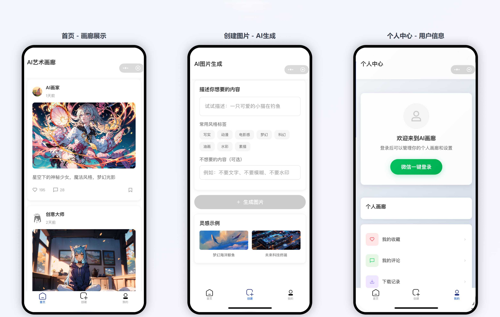

# 极绘光影 · AI 画廊小程序

  

 

> 一个基于「微信小程序 + 云开发 + 通义万相」的 AI 文生图小程序原型：写一句提示词，云端生成图片，直接在手机上查看。



| 项目信息 | 说明                                                                      |
| ---- | ----------------------------------------------------------------------- |
| 作者   | [@xuanani](https://github.com/xuanani)                                  |
| 仓库   | <https://github.com/xuanani/jihui-guangying-art>                        |
| 前端   | 微信小程序原生（glass-easel 组件框架），UI 组件库 TDesign Miniprogram 1.10.1             |
| 后端   | 微信云开发：云函数（login / text2image / updateUserInfo）+ 云数据库 `users` 集合 + 云存储   |
| 生成模型 | 阿里云百炼 DashScope 通义万相 `wanx2.1-t2i-plus`（异步文生图）                          |
| 源码目录 | 仓库根目录下的 `极绘光影Art/`（导入开发者工具时请选这个目录，不要选仓库根目录）                             |
| 开发语言 | JavaScript（小程序端 + Node.js 云函数）                                          |
| 项目状态 | 可运行原型，非完整产品（见[功能实现状态](#功能实现状态)）                                         |
| 许可证  | [MIT](LICENSE)（第三方组件见 [THIRD-PARTY-NOTICES.md](THIRD-PARTY-NOTICES.md)） |

---

## 目录

- [一、这个项目解决什么问题](#一这个项目解决什么问题)
- [二、主要功能](#二主要功能)
  - [功能实现状态](#功能实现状态)
  - [各页面说明](#各页面说明)
- [三、五分钟跑起来（TL;DR）](#三五分钟跑起来tldr)
- [四、目录结构](#四目录结构)
- [五、安装方法](#五安装方法)
- [六、使用方法](#六使用方法)
- [七、输入输出示例](#七输入输出示例)
- [八、已知限制与待修问题](#八已知限制与待修问题)
- [九、贡献指南](#九贡献指南)
- [十、文档与参考](#十文档与参考)
- [十一、致谢](#十一致谢)
- [十二、许可证](#十二许可证)

---

## 一、这个项目解决什么问题

对普通用户来说，用 AI 生成一张图通常要在网页、客户端之间来回切换：找模型、学提示词、提交任务、等待、下载，链路长、门槛高，作品也很难沉淀。

本项目把这条链路收进微信小程序：

1. 在手机上用自然语言描述画面，可附加「不想要的内容」；
2. 云函数代替前端调用通义万相，创建**异步**生成任务（避免小程序端请求超时）；
3. 小程序每 3 秒轮询一次任务状态，成功后直接渲染生成结果；
4. 生成结果直接显示在创建页，可重新生成；作品详情页里的「创作信息」目前是示例数据，不会展示你刚生成的图。

同时提供画廊信息流、个人中心、我的画廊、设置等页面骨架，用于演示完整的「AI 创作社区」产品形态。

> ⚠️ **这是可运行原型，不是完整产品。** 真正打通后端的只有三块：**微信登录、资料修改、文生图**。信息流、点赞、评论、我的画廊等大量数据仍是本地 mock（详见 [功能实现状态](#功能实现状态)）。

---

## 二、主要功能

### 功能实现状态

| 模块                     | 能力                                   | 当前状态                                 |
| ---------------------- | ------------------------------------ | ------------------------------------ |
| 登录 / 资料（`profile`）     | 微信一键登录、`users` 集合持久化、头像上传云存储、昵称/简介修改 | ✅ 真实云开发                              |
| AI 文生图（`create`）       | 提示词 → 云函数 → 通义万相 → 轮询 → 展示结果         | ✅ 真实调用（需配置 API Key）                  |
| 首页信息流（`home`）          | 作品流、下拉刷新、上拉加载、点赞/收藏                  | 🟡 交互真实，数据为本地 mock                   |
| 作品详情（`artwork-detail`） | 大图预览、创作信息、点赞/收藏/评论、分享面板              | 🟡 单条 mock 数据，互动只改本地状态               |
| 我的画廊（`my-gallery`）     | 网格、公开/私密筛选、公开切换、删除、批量操作              | 🟡 内存操作，`onShow` 后恢复 mock            |
| 设置（`settings`）         | 隐私开关、关于、联系客服、清除缓存、注销账户               | 🟡 部分写本地 storage，多数为模拟提示             |
| 作品发布 / 收藏夹 / 搜索 / 关注   | —                                    | ⛔ 未实现（`design/requirement.md` 仅为设计稿） |

### 各页面说明

底部 tabBar 共三个入口：**首页**（`pages/home`）、**创建**（`pages/create`）、**我的**（`pages/profile`）；作品详情、我的画廊、设置从页面内跳转进入。

#### 1）创建页 `pages/create` —— 唯一的真实 AI 生成入口

- 提示词输入框：上限 500 字，占位提示「试试描述：一只可爱的小猫在钓鱼」。
- 8 个风格标签：写实、动漫、电影感、梦幻、科幻、油画、水彩、素描。**注意：当前只切换选中样式，标签不会被拼进提示词**（`onTagSelect` 只改 `selected`，`addTagToPrompt` 未被调用）。
- 负面提示词输入框：占位提示「例如：不要文字、不要模糊、不要水印」。
- 点击「生成图片」后调用云函数 `text2image`（`action: 'create'`），拿到 `output.task_id` 后每 3 秒轮询 `action: 'query'`。
- 进度条是**估算动画**（每秒随机递增、上限 90%），不是服务端真实进度；文案显示「预计需要30-60秒」。
- 成功：`output.task_status === 'SUCCEEDED'` 时取 `output.results[0].url` 显示；失败/取消：Toast「生成失败，请重试」。
- 结果区提供「重新生成」；另有「灵感示例」两张卡片，弹窗展示提示词并可一键填入。
- **没有发布 / 保存按钮**：生成结果不会进入「我的画廊」。

#### 2）首页 `pages/home`

- 作品卡片：作者头像/昵称、发布时间、作品图、提示词、点赞数、评论数、收藏按钮。
- 下拉刷新、上拉加载更多（最多 3 页，之后显示「没有更多作品了」）。
- 点击卡片进入作品详情；点赞/收藏仅切换图标与计数，**不写数据库**。
- 卡片上的评论按钮绑定了 `onComment`，但 `home.js` 中未定义该函数，点击无响应（见「已知限制」）。
- 没有搜索入口（`onSearch` 只有一句「搜索功能开发中」，且 WXML 未渲染）。

#### 3）作品详情 `pages/artwork-detail`

- 展示大图（点击可预览）、作者、发布时间、点赞/收藏、创作信息（提示词、负面提示词、标签）。
- 评论区展开/收起，可本地新增评论、点赞评论（只在内存里）。
- 「使用此提示词」会跳转到创建页并带上 `prompt` 参数，但 `create.js` 的 `onLoad` 未读取该参数，**实际不会回填**。
- 分享弹窗包含「微信好友 / 朋友圈 / 复制链接」，但前两个处理函数未定义，只有「复制链接」可用（链接为占位域名 `https://ai-gallery.com/artwork/{id}`）。
- 代码里有 `onDownload`（`wx.downloadFile` + `wx.saveImageToPhotosAlbum` 保存原图）和 `onMore`（举报/海报），但 WXML 未绑定入口，当前不可触发。

#### 4）个人中心 `pages/profile`

- 未登录：显示「微信一键登录」。登录流程为 `wx.getUserProfile` → 云函数 `login`（按 `openid` 查询 `users`，不存在则自动创建）→ 写入 `app.globalData`。
- 已登录：毛玻璃用户卡（头像、昵称、ID、简介、作品数/获赞/粉丝）、编辑资料按钮、个人画廊网格。
- 编辑资料：可修改头像（`wx.chooseMedia` → `wx.cloud.uploadFile` 上传到 `users/avatars/...` → 云函数 `updateUserInfo`）、昵称与简介（`wx.showModal` 的 `editable` 输入）。
- 菜单入口：我的画廊、设置；「我的收藏 / 我的评论 / 下载记录」仅弹出「功能开发中」。
- 退出登录：清除本地 storage 中的登录态。
- 个人画廊与统计数据当前是 mock（默认用户「创意达人」、作品 12 / 获赞 1200 / 粉丝 89）。

#### 5）我的画廊 `pages/my-gallery`

- 网格展示作品，带公开/私密标签；顶部「全部 / 公开 / 私密」切换只改变高亮，**列表不会真的过滤**（`filterArtworks` 只 `console.log`）。
- 公开/私密切换、删除、批量公开/批量删除只修改内存列表，`onShow` 重新加载 mock 数据后即恢复。
- 「创建作品」跳转创建页；分享动作表中「分享到微信 / 生成海报」提示开发中，仅「复制链接」可用。

#### 6）设置 `pages/settings`

|   |   |
| - | - |

|   |   |
| - | - |

- 按 `?type=privacy|about` 显示「隐私设置」或「关于我们」。
- 隐私开关写入 storage 的 `privacySettings`（但 `onLoad` 不回读，刷新后回到默认值）。
- 关于页信息（`aboutInfo`）：版本 1.0.0、构建 20250923、开发者 xuanani、开源协议 MIT / Copyright (c) 2026 xuanani、项目主页（GitHub）、联系邮箱 `xuanani@foxmail.com`；「项目主页」与「联系我们」点击后均为复制链接/邮箱，因为小程序内不能直接打开外部网页。
- 「检查更新 / 意见反馈 / 清除缓存」为 `setTimeout` 模拟，清缓存不会真正清理 storage。
- 「注销账户」会 `wx.clearStorageSync()` 并 `reLaunch` 回首页。

---

## 三、五分钟跑起来（TL;DR）

```bash
git clone https://github.com/xuanani/jihui-guangying-art.git
```

1. 微信开发者工具「导入项目」，目录选 `极绘光影Art/`，AppID 填自己的；
2. 把 3 处云环境 ID 换成自己的（见 [5.3](#53-配置云开发环境)）；
3. 云开发控制台建 `users` 集合，权限「仅创建者可读写」；
4. 右键 `cloudfunctions/` 下 3 个函数 →「上传并部署：云端安装依赖」；
5. 给 `text2image` 云函数配环境变量 `DASHSCOPE_API_KEY`；
6. 开发者工具勾选「不校验合法域名」，编译运行。

只想先看看界面？导入时用默认的 `touristappid`，可以浏览所有页面（登录与生图会失败）。

---

## 四、目录结构

```text
GitHub极绘光影/
├── README.md                     # 本文件（项目总说明）
├── LICENSE                       # MIT 许可证
├── THIRD-PARTY-NOTICES.md        # 第三方组件与素材声明
├── .gitignore                    # 忽略 .env / node_modules / 本地私有配置
├── 图片介绍.jpg                   # 三屏界面原型图
├── design/requirement.md         # 产品需求文档（发布流程等尚未实现）
└── 极绘光影Art/                   # 微信小程序工程根目录（用开发者工具导入这一层）
    ├── app.js                    # 云开发初始化、全局登录态、检查更新
    ├── app.json                  # 页面注册 / tabBar / 窗口样式
    ├── app.wxss                  # 全局样式
    ├── sitemap.json
    ├── project.config.json       # 项目配置（AppID 已置占位值、cloudfunctionRoot）
    ├── package.json              # 仅前端依赖 tdesign-miniprogram
    ├── .env.example              # 环境变量示例（不含真实 Key，云函数不读取）
    ├── cloudfunctions/           # 云函数（无 node_modules，需云端安装依赖）
    │   ├── login/                # 登录 / 注册（users 集合）
    │   ├── text2image/           # 通义万相异步文生图（create / query）
    │   └── updateUserInfo/       # 更新昵称 / 头像 / 简介
    ├── pages/
    │   ├── home/                 # 首页信息流
    │   ├── create/               # AI 图片生成
    │   ├── profile/              # 个人中心
    │   ├── artwork-detail/       # 作品详情
    │   ├── my-gallery/           # 我的画廊
    │   └── settings/             # 设置 / 关于
    ├── icon/                     # tabBar 图标 A.png ~ F.png
    ├── images/                   # 只有 1.jpg（默认头像 default-avatar.png 缺失）
    ├── utils/util.js             # 时间格式化工具
    ├── miniprogram_npm/          # 已构建的 TDesign 组件
    └── node_modules/             # 前端依赖（不入库）
```

---

## 五、安装方法

### 5.1 前置条件

| 依赖      | 要求                           |
| ------- | ---------------------------- |
| 微信开发者工具 | Stable 版，开发时使用基础库 3.10.1     |
| 小程序账号   | 已注册的小程序，且**已开通云开发**（获得环境 ID） |
| 阿里云百炼   | 已开通模型服务，持有 DashScope API Key |

费用参考（以官方为准）：`wanx2.1-t2i-plus` 约 0.20 元/张，新开通 180 天内 500 张免费额度；`wanx2.1-t2i-turbo` 约 0.14 元/张。生成的图片 URL **仅保留 24 小时**。

### 5.2 导入项目

1. 克隆或下载本仓库。
2. 打开微信开发者工具 →「导入项目」，目录选择 **`极绘光影Art/`**（包含 `project.config.json` 的那一层，不是仓库根目录）。
3. AppID 填自己的小程序 AppID。仓库里 `project.config.json` 的 `appid` 已置为占位值 `touristappid`（游客模式），可直接导入预览界面，但登录与云开发必须换成真实 AppID。

### 5.3 配置云开发环境

云开发环境 ID 只需改**一处**：`极绘光影Art/app.js` 顶部的常量。

```js
// app.js
const CLOUD_ENV_ID = 'your-cloud-env-id'   // ← 换成你自己的环境 ID
```

保持占位值时，代码会跳过 `wx.cloud.init()` 并打印一条警告 —— 界面仍可预览，但微信登录、资料修改、文生图不可用。

三个云函数 `login` / `text2image` / `updateUserInfo` 都是 `cloud.init()` 无参初始化，自动跟随它们被部署到的环境，无需修改。

### 5.4 创建数据库集合

在云开发控制台 → 数据库，创建集合 `users`，权限建议「仅创建者可读写」。登录云函数会自动写入如下文档：

```json
{
  "openid": "o-xxxxxxxxxxxxxxxx",
  "nickname": "新用户1234",
  "avatar": "https://thirdwx.qlogo.cn/...",
  "bio": "",
  "artworks": 0,
  "likes": 0,
  "fans": 0,
  "followings": 0,
  "createTime": "2025-01-01T00:00:00.000Z",
  "updateTime": "2025-01-01T00:00:00.000Z"
}
```

### 5.5 部署云函数

`cloudfunctions/` 下**没有提交 `node_modules`**，必须用「云端安装依赖」方式部署：

1. 在开发者工具左侧资源管理器中，右键 `cloudfunctions/login` →「上传并部署：云端安装依赖（不上传 node_modules）」；
2. 同样部署 `cloudfunctions/text2image`（依赖 `wx-server-sdk ~2.0.0`、`axios ^1.6.2`）；
3. 同样部署 `cloudfunctions/updateUserInfo`。

### 5.6 配置 DashScope API Key（否则无法生成图片）

在云开发控制台 → 云函数 → `text2image` → 配置 → 环境变量，新增：

| 变量名                 | 值                      |
| ------------------- | ---------------------- |
| `DASHSCOPE_API_KEY` | 你的百炼 API Key（`sk-` 开头） |

云函数只从 `process.env.DASHSCOPE_API_KEY` 读取，**不会读取仓库里的 `.env` 文件**。未配置时云函数日志会打印「未配置DASHSCOPE_API_KEY环境变量」，生成会失败。

> 仓库里的 `极绘光影Art/.env.example` 只是格式示例，请勿把它改成真实 Key 后提交。

### 5.7 ⚠️ 安全提示（务必处理）

本仓库曾提交过一个真实的 DashScope API Key（`.env`）。当前仓库已删除该文件，并加入 `.gitignore`，同时提供不含真实 Key 的 `.env.example` 作为格式示例。**但删除文件不等于密钥失效**——如果这个仓库曾经推送到任何远端，请务必：

1. 立即到阿里云百炼控制台**吊销并重新生成**该 Key；
2. 确认 `git log -S "sk-"` 中没有残留该 Key 的历史提交（如有，需改写历史或直接重建仓库）；
3. 新 Key 只放在云函数环境变量里，不要提交到任何代码仓库。

> 另注：小程序云函数**不会**读取仓库里的 `.env`，它只从云函数环境变量 `DASHSCOPE_API_KEY` 取值。

### 5.8 图片域名白名单

- 真实生成图：`https://dashscope-result-*.oss-cn-*.aliyuncs.com/...`
- mock 数据图：`youke1.picui.cn`、`images.unsplash.com`

开发阶段可在开发者工具「详情 → 本地设置」勾选「不校验合法域名、web-view（业务域名）、TLS 版本以及 HTTPS 证书」。正式发布前需在小程序后台「开发管理 → 开发设置 → 服务器域名」中把图片域名加入 `downloadFile` 合法域名，否则图片可能无法显示 / 保存相册失败。

### 5.9 重建 TDesign 组件（可选）

`miniprogram_npm/tdesign-miniprogram` 已构建好，开箱可用。若需升级或重新构建：

```bash
cd 极绘光影Art
npm install
# 然后在开发者工具中执行：工具 → 构建 npm
```


---

## 六、使用方法

### 6.1 生成你的第一张图

1. 打开小程序，底部 tabBar 点击「创建」。
2. 在「描述你想要的内容」中输入提示词，例如：`一只橘猫趴在窗台上晒太阳，水彩风格，柔和光影，高清细节`。
3. （可选）在「不想要的内容」中填写负面提示词，例如：`文字, 模糊, 水印, 变形`。
4. 点击「生成图片」，页面显示「AI正在创作中...」和进度条（进度为估算值）。
5. 等待约 30–60 秒，成功后显示 1024×1024 的结果图，并提示「生成完成！」。
6. 不满意可点「重新生成」；想换个思路可点「灵感示例」中的卡片，弹窗里点「使用此提示词」填入。

> 提示词技巧（真实影响出图效果）：按「主体 + 场景 + 风格 + 光照 + 画质」组织；中文即可；负面词用逗号分隔。项目已开启 `prompt_extend`（大模型自动改写提示词）且 `watermark: false`（不加水印）。

### 6.2 登录与完善资料

1. tabBar「我的」→「微信一键登录」→ 授权后自动创建/读取 `users` 记录。
2. 点击头像 → 从相册/相机选择图片 → 上传到云存储并更新资料。
3. 「编辑资料」→ 修改昵称或简介 → 云函数写入数据库。
4. 「退出登录」清除本地登录态（不会删除云端用户数据）。

### 6.3 浏览与互动

- 首页下拉刷新、上拉加载；点击卡片进入详情。
- 点赞 / 收藏 / 评论只改变当前页面状态，退出重进即还原。
- 详情页「使用此提示词」目前不会回填到创建页（已知限制）。

### 6.4 我的画廊与设置

- 「我的画廊」可切换公开/私密、删除、批量操作，但都只作用于内存，刷新即恢复 mock。
- 「设置 → 关于我们」查看版本信息；「隐私设置」开关会被保存到本地 storage。


### 6.5 常见问题

| 现象                  | 原因与处理                                                   |
| ------------------- | ------------------------------------------------------- |
| 点「生成图片」只弹「生成失败，请重试」 | 未配置 `DASHSCOPE_API_KEY`、Key 无效、额度耗尽或云函数未部署成功；看云函数日志定位   |
| 进度一直停在 90%          | 任务仍在 PENDING/RUNNING；当前代码**没有轮询超时和取消机制**，可能长时间循环，退出页面即可 |
| 图片显示不出来             | 图片域名未加白名单，或生成图已超过 24 小时有效期                              |
| 保存相册失败              | 未配置 `downloadFile` 合法域名，或用户拒绝了相册权限（且详情页暂无保存入口）          |
| 修改资料报「更新资料失败，请重试」   | `users` 集合未创建，或当前 openid 无对应记录（先登录一次）                   |

---

## 七、输入输出示例

### 7.1 文生图完整链路

**① 页面输入**（`pages/create/create.js` 中固定 `size` 与 `n`）：

```json
{
  "action": "create",
  "prompt": "一只橘猫趴在窗台上晒太阳，水彩风格，柔和光影",
  "negativePrompt": "文字, 模糊, 水印",
  "size": "1024*1024",
  "n": 1
}
```

小程序端调用：

```js
const createResult = await wx.cloud.callFunction({
  name: 'text2image',
  data: { action: 'create', prompt, negativePrompt, size: '1024*1024', n: 1 }
})
const taskId = createResult.result.output.task_id
```

**② 云函数转发给通义万相**（`POST https://dashscope.aliyuncs.com/api/v1/services/aigc/text2image/image-synthesis`）：

```json
{
  "model": "wanx2.1-t2i-plus",
  "input": {
    "prompt": "一只橘猫趴在窗台上晒太阳，水彩风格，柔和光影",
    "negative_prompt": "文字, 模糊, 水印"
  },
  "parameters": {
    "size": "1024*1024",
    "n": 1,
    "prompt_extend": true,
    "watermark": false
  }
}
```

**③ 创建任务的返回**（原样透传给小程序）：

```json
{
  "output": {
    "task_status": "PENDING",
    "task_id": "0385dc79-5ff8-4d82-bcb6-xxxxxx"
  },
  "request_id": "4909100c-7b5a-9f92-bfe5-xxxxxx"
}
```

**④ 轮询请求**（每 3 秒一次，`GET https://dashscope.aliyuncs.com/api/v1/tasks/{task_id}`）：

```json
{ "action": "query", "taskId": "0385dc79-5ff8-4d82-bcb6-xxxxxx" }
```

**⑤ 任务成功时的返回**：

```json
{
  "request_id": "f767d108-7d50-908b-a6d9-xxxxxx",
  "output": {
    "task_id": "0385dc79-5ff8-4d82-bcb6-xxxxxx",
    "task_status": "SUCCEEDED",
    "results": [
      {
        "orig_prompt": "一只橘猫趴在窗台上晒太阳，水彩风格，柔和光影",
        "actual_prompt": "一只橘色短毛猫慵懒地趴在木质窗台上……（prompt_extend 改写后的提示词）",
        "url": "https://dashscope-result-wlcb.oss-cn-wulanchabu.aliyuncs.com/1.png"
      }
    ],
    "task_metrics": { "TOTAL": 1, "SUCCEEDED": 1, "FAILED": 0 }
  },
  "usage": { "image_count": 1 }
}
```

**⑥ 页面最终展示**：`output.results[0].url` 渲染到结果区，进度条置 100%，Toast「生成完成！」，并提供「重新生成」。状态为 `FAILED` / `CANCELED` 时抛错并提示「生成失败，请重试」。

### 7.2 登录云函数

请求（`wx.cloud.callFunction({ name: 'login' })`，无需业务参数）：

```json
{}
```

返回：

```json
{
  "success": true,
  "data": {
    "userInfo": {
      "userId": "65f0c3a1e4b0a1b2c3d4e5f6",
      "openid": "o-xxxxxxxxxxxxxxxx",
      "nickname": "新用户1234",
      "avatar": "https://thirdwx.qlogo.cn/...",
      "bio": "",
      "stats": { "artworks": 0, "likes": 0, "fans": 0 }
    },
    "isNewUser": true,
    "openid": "o-xxxxxxxxxxxxxxxx",
    "unionid": null
  }
}
```

> `unionid` 仅在用户绑定微信开放平台账号时才有值，否则为 `undefined`（示例中写作 `null`）。

### 7.3 更新资料云函数

请求：

```json
{ "nickname": "光影绘者", "bio": "用提示词画画" }
```

返回：

```json
{
  "success": true,
  "data": {
    "userInfo": {
      "userId": "65f0c3a1e4b0a1b2c3d4e5f6",
      "openid": "o-xxxxxxxxxxxxxxxx",
      "nickname": "光影绘者",
      "avatar": "https://thirdwx.qlogo.cn/...",
      "bio": "用提示词画画",
      "stats": { "artworks": 0, "likes": 0, "fans": 0 }
    }
  }
}
```

### 7.4 失败返回示例

```json
{ "success": false, "message": "任务ID不能为空", "error": {} }
{ "success": false, "message": "不支持的操作: delete", "error": {} }
{ "success": false, "message": "更新资料失败，请重试", "error": {} }
```

> 说明：`text2image` 成功时直接返回 DashScope 的原始响应（无 `success` 字段），失败时才返回 `{ success: false, message, error }`；小程序端以 `result.output` 是否存在判断成功。

---

## 八、已知限制与待修问题

以下问题与源码一一对应，便于后续迭代（也适合作为第一个 PR 的切入点）：

1. **首页数据是 mock**：`pages/home/home.js` 内置 3 条 + `generateMockData()` 每页生成 3 条，最多 3 页，图片来自 `youke1.picui.cn`。
2. **互动不落库**：首页与详情页的点赞、收藏、评论只 `setData`，不写数据库。
3. **评论按钮无响应**：`pages/home/home.wxml:64` 绑定了 `bindtap="onComment"`，但 `home.js` 没有 `onComment`。
4. **点头像取不到用户 ID**：`pages/home/home.wxml:27` 用 `data-user-id`，`home.js` 读的是 `dataset.userId`，跳转用户主页无效。
5. **风格标签不生效**：`create.js` 的 `onTagSelect` 只切换选中态，`addTagToPrompt` 定义但从未调用。
6. **「使用此提示词」不回填**：`artwork-detail` 跳 `create?prompt=...`，但 `create.js` 的 `onLoad` 未读取参数。
7. **我的画廊筛选无效**：`my-gallery.js` 的 `filterArtworks` 只 `console.log`；`onShow` 会重新加载 mock，公开/删除等操作不持久。
8. **详情页缺入口**：`artwork-detail.wxml` 未绑定 `onDownload` / `onShare` / `onMore`；分享弹窗里的 `onShareToWeChat`、`onShareToMoments` 在 JS 中不存在，仅「复制链接」可用。
9. **默认头像缺失**：`profile.js` 引用 `/images/default-avatar.png`，但 `images/` 目录只有 `1.jpg`。
10. **没有发布能力**：生成结果不能保存为作品、不能进「我的画廊」（`design/requirement.md` 中的发布流程未实现）。
11. **设置页多为模拟**：「清除缓存」不清 storage，「隐私开关」写入后不回读，「检查更新/意见反馈」为定时器模拟。
12. **轮询无超时/取消**：`queryTaskResult` 的 `while` 循环没有最大次数与 `onUnload` 清理，任务长时间 `PENDING` 时会一直查询。
13. ~~密钥泄露风险~~：原 `极绘光影Art/.env` 含真实 `DASHSCOPE_API_KEY`，已删除并加入 `.gitignore`，旧 Key 已在百炼控制台吊销。
14. **模板残留页**：`pages/index/`、`pages/logs/` 未在 `app.json` 注册，不可达，可删除。

---

## 九、贡献指南

欢迎提 Issue 和 PR。这个项目的定位是**教学/演示原型**，所以「把 mock 替换成真实实现」比「加新功能」更有价值。

### 提交前

- 不要提交 `.env`、真实 API Key、`node_modules/`、`project.private.config.json`；
- 新增依赖前先在 Issue 里说明理由（项目刻意保持依赖极简）；
- 小程序端用 2 空格缩进，跟随现有代码风格；
- 改动云函数请同步更新本文档第六章的接口示例。

### 适合上手的第一个 PR

上面[已知限制](#八已知限制与待修问题)里的第 3、4、5、6、9 条都是小范围、边界清晰的问题，适合作为第一次贡献。

### 提交信息

建议使用语义化前缀：`feat:` / `fix:` / `docs:` / `refactor:` / `chore:`。

---

## 十、文档与参考

- [`design/requirement.md`](design/requirement.md)：产品需求与页面设计（立项原稿，文首标注了哪些已实现、哪些没有，以「功能实现状态」表为准）。
- 通义万相文生图 API 文档：<https://help.aliyun.com/zh/model-studio/text-to-image>（模型参数、任务状态、计费与限流以官方为准）。
- 阿里云百炼控制台：<https://bailian.console.aliyun.com/>（模型开通、API Key、用量与计费）。
- 微信云开发文档：<https://developers.weixin.qq.com/miniprogram/dev/wxcloud/basis/getting-started.html>。

---

## 十一、致谢

- [TDesign Miniprogram](https://github.com/Tencent/tdesign-miniprogram)：界面组件库（MIT）。
- [微信云开发](https://developers.weixin.qq.com/miniprogram/dev/wxcloud/basis/getting-started.html)：云函数、数据库、存储。
- [阿里云百炼 · 通义万相](https://help.aliyun.com/zh/model-studio/)：文生图模型服务。

---

## 十二、许可证

本项目以 **MIT** 协议开源，Copyright (c) 2026 xuanani，见 [LICENSE](LICENSE)。你可以自由使用、修改、分发和商用，只需保留版权与许可声明。

需要说明的是，MIT 只覆盖**代码**：

- 随仓库分发的 TDesign Miniprogram 组件（MIT，版权归 TDesign）及其他第三方依赖，见 [THIRD-PARTY-NOTICES.md](THIRD-PARTY-NOTICES.md)；
- `图片介绍.jpg`、`icon/*.png`、`images/1.jpg` 等素材与「极绘光影」名称/标识不在授权范围内；
- 通过通义万相生成的图片内容，其使用须遵守阿里云百炼的服务条款。

---

如果这个项目对你有帮助，欢迎点个 ⭐ Star。
